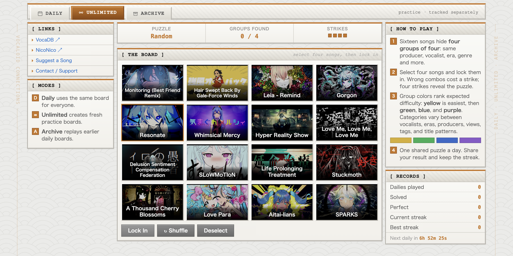
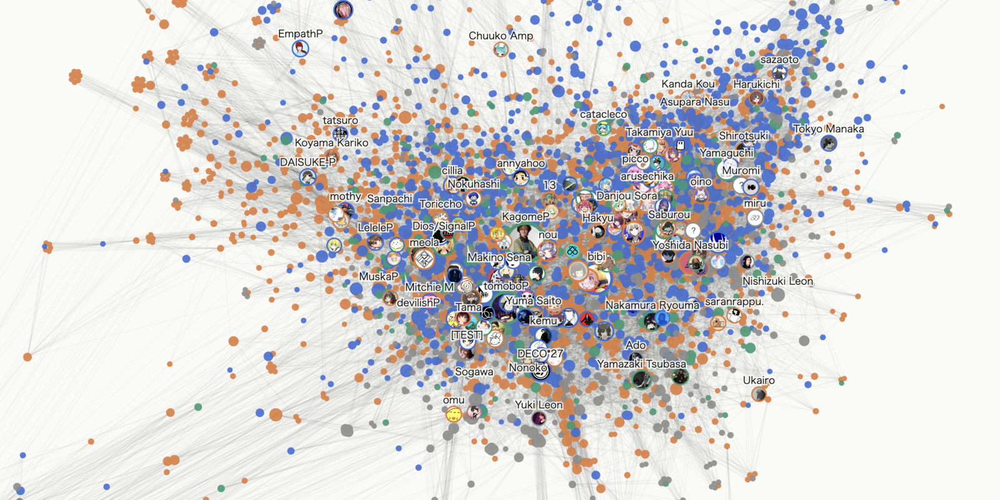

  
   
  art by <a href="https://www.pixiv.net/en/users/10109777">紺屋 (KonYa666)</a>

  hi, i'm kzen. i like building things with data, music, and whatever ideas happen to interest me. 
  right now that mostly means vocaloid, networks, and interactive things you can poke at.

  i got into this by wanting to turn the music i love into something you can play with or explore. 
  so far that's a guessing game where you sort songs into hidden groups, and a network for finding patterns in who works with who.

<table align="center">
  <tr>
    <td width="50%" align="center">
      
       
      <a href="https://vocaloidle.sodapines.dev/"><b>vocaloidle</b></a>
       
      a growing collection of vocaloid games, built around a daily puzzle.
    </td>
    <td width="50%" align="center">
      
       
      <a href="https://sodapines.github.io/vocasynth-network/"><b>vocasynth-network</b></a>
       
      an interactive map of how vocaloid producers connect.
    </td>
  </tr>
</table>

  mostly javascript, python, and html/css, plus some r, cloudflare workers, and jupyter notebooks

  <i>most of my projects start with me wondering if something would be interesting to make, and then spending way too much time finding out.</i>

  
  

